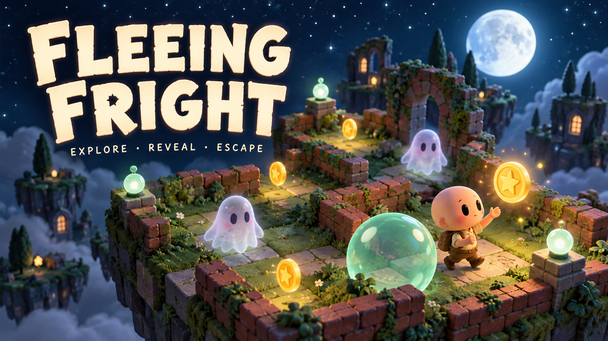
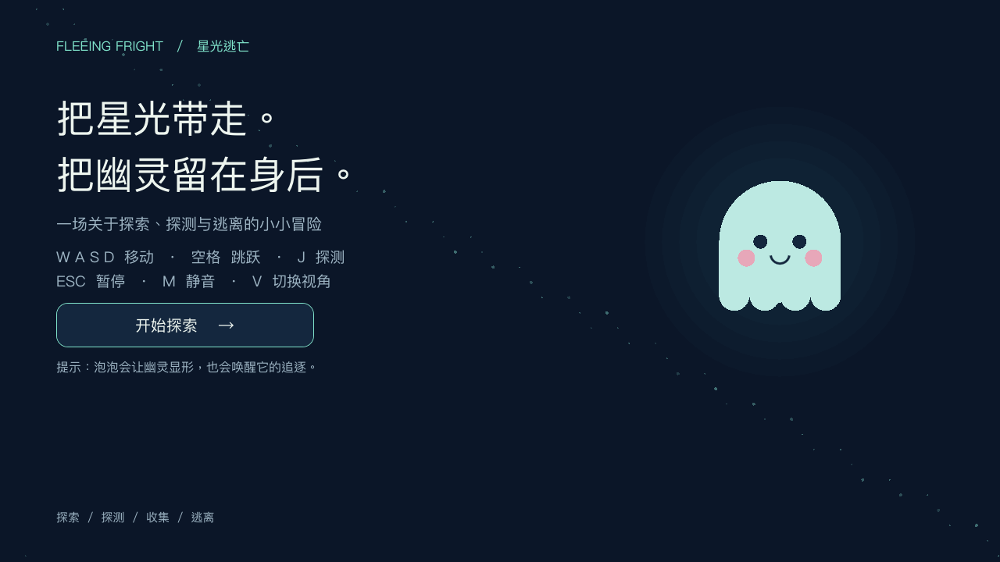
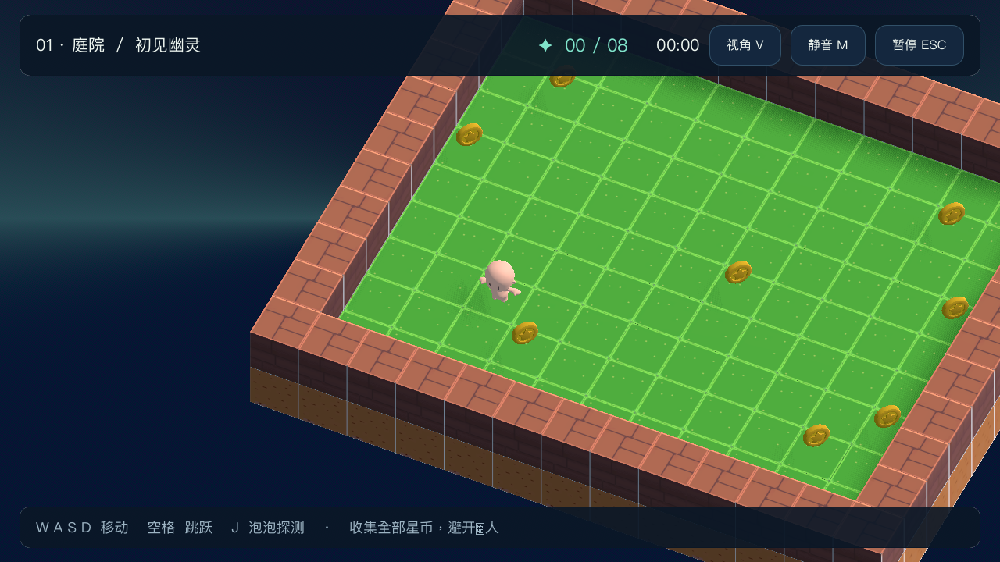
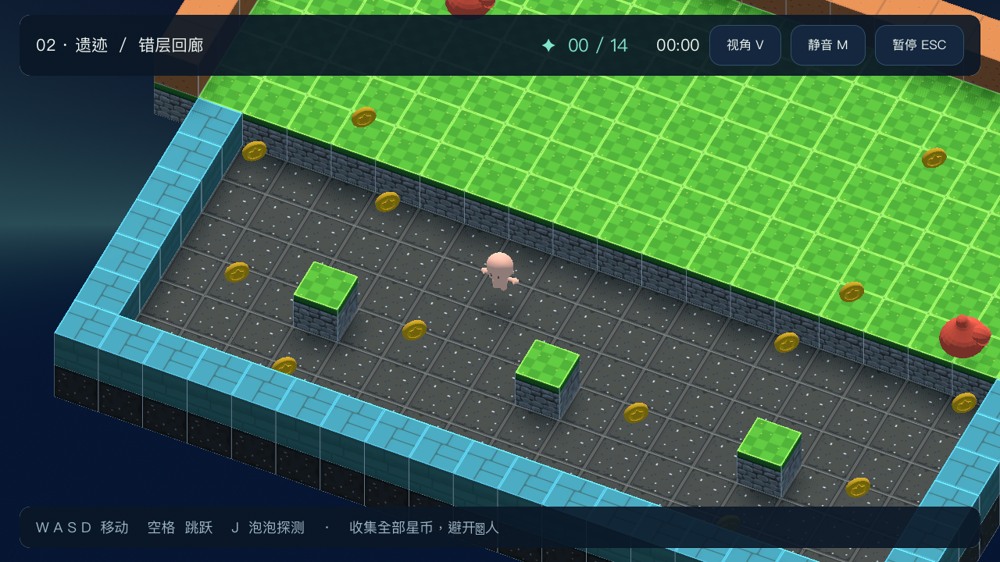
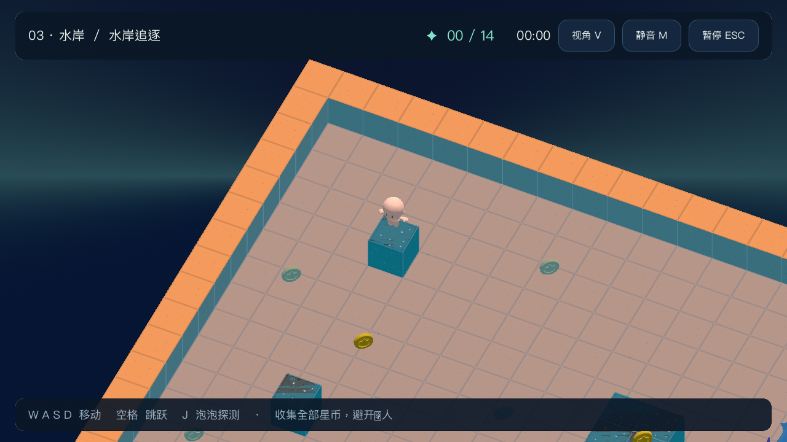
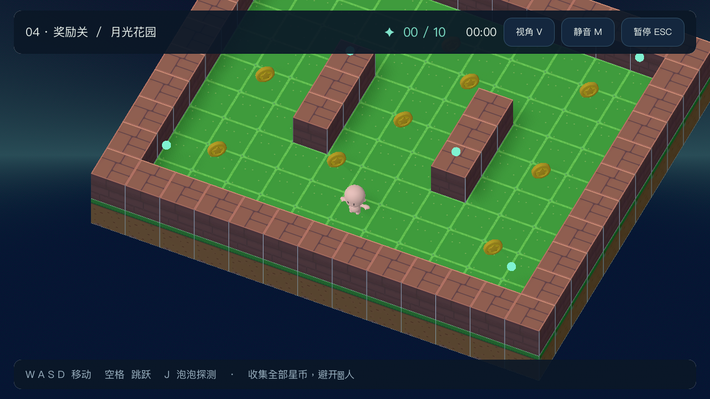
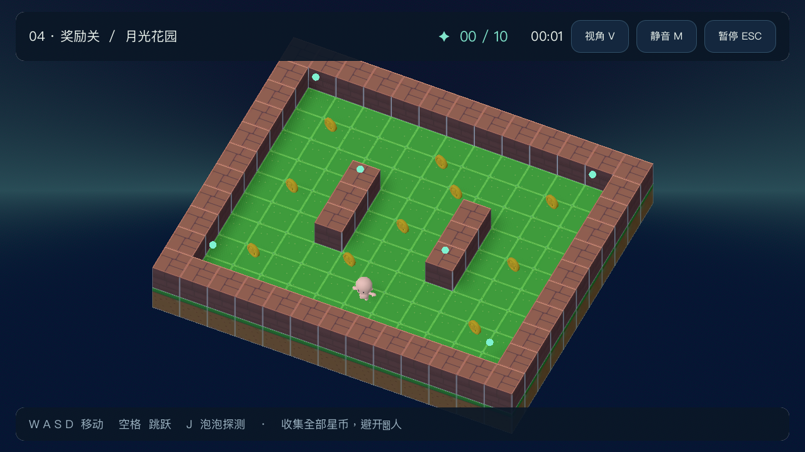

<div align="center">



# Fleeing Fright · 星光逃亡

**把星光带走，把幽灵留在身后。**

Godot 3D 小游戏 · 四个独立关卡 · 探索 / 探测 / 收集 / 逃离

[开始游玩](#开始游玩) · [看看关卡](#四段小小的冒险) · [下载资源包](https://github.com/shanghuaye504-byte/fleeing-fright/releases)

</div>

> 封面为 AI 生成的宣传插画。下方菜单与关卡图片均为游戏实际运行截图。

## 星光很好找，幽灵可不一定

在方块搭成的庭院、错层回廊与水岸之间，收集每一枚星币。你能沿网格四向移动，也能跳上高台。斜俯视镜头平滑跟随角色，按 V 可切换全景。按下 **J**，向面前发射一枚探测泡泡：幽灵起初完全不可见，只有泡泡命中后才显形并开始追逐。发现它以后，记得留一条退路。

没有战斗升级或复杂背包。看清路线，控制距离，把这一关的星光全部带走。



## 开始游玩

### 从源码运行

1. 下载本仓库 ZIP 并解压，或克隆仓库。
2. 用 Godot 打开根目录的 `project.godot`，等待首次资源导入。
3. 按 **F5** 从主菜单开始。

项目原配置为 Godot 4.5，本次完整验证使用 **Godot 4.7.1 / Forward+**，建议使用 4.7.1 复现。无需额外插件。

```sh
git clone https://github.com/shanghuaye504-byte/fleeing-fright.git
cd fleeing-fright
godot --editor --path .
```

命令中的 `godot` 请替换为本机可用的命令；部分系统使用 `godot4`。

### 使用 Release 资源包

下载 [Release](https://github.com/shanghuaye504-byte/fleeing-fright/releases) 中的 `FleeingFright.pck`，使用 **Godot 4.7.1** 启动：

```sh
godot --main-pack FleeingFright.pck
```

PCK 是已导出的游戏资源包，仍需 Godot 运行时。独立的 macOS、Windows 或 Linux 可执行程序可在编辑器的“项目 → 导出”中安装对应版本模板后导出；本次没有发布独立安装包。

## 操作与小提示

- **W / A / S / D**：四向移动，转向时自动靠齐网格。
- **空格**：跳跃；高低差也是绕行路线的一部分。
- **J**：向角色面对的方向发射探测泡泡。
- **ESC**：暂停或继续；暂停菜单中可重开、选关、返回首页。
- **M**：静音或恢复声音。
- **V**：在放大的跟随视角与全景视角之间切换；跳跃不会带着镜头上下晃动。

收集这一关的全部星币即可通关。幽灵、独眼怪与鲨鱼接触到你会结束本次挑战；可以立即重试。所有关卡从一开始就开放，收集进度与计时在每次挑战时重新开始。

## 四段小小的冒险

### 01 · 初见幽灵

8 枚星币，一个开放庭院。熟悉转向与探测，在靠近星币前先探测看不见的危险。



### 02 · 错层回廊 / 03 · 水岸追逐

错层回廊有 14 枚星币与横向巡逻的独眼怪；水岸追逐有 14 枚星币、不同高度的路线与追踪玩家的鲨鱼。沿用原关卡布局，增加清晰的目标、暂停与结果反馈。

 

### 04 · 月光花园 · 新增奖励关

10 枚星币、两道矮墙、两只幽灵。环形小径让你可以绕行，薄荷色路灯标出庭院边缘。复用原有角色与规则，适合用来练习“先探测，再选择路线”。



按 **V** 切换全景，确认下一段探索路线：



## 这一版做了什么

- 统一中文菜单、选关、胜负页面、图标与配色，补全第三关入口和首关路径。
- 增加星币进度、计时、暂停、重开、连续进入下一关与全局静音。
- 星币改为随时间平滑旋转、轻微浮动，收集后立即隐藏并只计数一次。
- 调整夜色环境与音量，加入轻量环境声；泡泡有存活上限，轨迹随场景清理。
- 修正幽灵无效节点引用、随机生成时的位置初始化、敌人重复结算，以及独眼怪两侧受阻时的循环风险。
- 新增月光花园；原三关的地形、移动参数与碰撞层保持原有设置；镜头改为斜俯视跟随，可切换全景。

## 验证与已知边界

本次使用 Godot 4.7.1 完成场景回归和实际画面检查。源码与导出的 PCK 均通过 87 项流程检查，覆盖四关加载、物理碰撞收集与失败、暂停、静音、胜负切换、重开、幽灵探测和对象清理，以及完全隐形、探测显形、镜头跟随与全景取景。奖励关另以实际移动输入收集全部 10 枚星币并通关；该可达性检查将敌人固定在出生点。

```sh
godot --headless --path . --script res://tests/smoke.gd
godot --headless --path . --script res://tests/walk_garden.gd
```

重新生成实际截图与 PCK：

```sh
godot --path . --resolution 1280x720 --script res://tests/capture.gd
godot --headless --path . --export-pack "Desktop PCK" FleeingFright.pck
```

原怪物 FBX 缺少旧路径中的 `PolyartMaster01.png`。这一版使用同一素材包已有的 `Albedo.png` 调色板副本补齐引用，保留现有场景材质。首次导入时，部分原始 FBX 仍会报告缺少作者机器上的外部贴图（玩家、素材包中的方块与未启用的怪物网格）。游戏场景已有覆盖材质，四关运行检查通过。这些原始引用保留记录，没有修改 FBX 二进制或猜测原图。另有一段 Ogg 的注释元数据告警。

原有关卡的随机敌人分布与难度没有重新平衡；完整的原三关人工无伤通关、其他操作系统原生导出和手柄体验尚未在本次验证。

## 素材与制作

原项目提供角色、幽灵、独眼怪、鲨鱼、方块和星币素材。本次继续使用这些资源，并保留原附带文件。

- 音效：Kenney Sci-Fi Sounds 与 Music Jingles；附带 CC0 许可。
- 方块：Devil's Work.shop Essential Isometric 3D Block Pack；许可见素材目录。
- 其他模型与字体：沿用原项目文件；各素材权利归原作者，未为整个素材集合追加统一许可。
- 封面：内置 `imagegen` 生成的宣传插画；[提示词与来源记录](_internal/artwork.md)。
- 实际截图：Godot 视口直接导出，可通过 `tests/capture.gd` 重现。

## Internal docs

- [`_internal/architecture.md`](_internal/architecture.md)：当前运行结构、素材路径和改动边界；代理在修改玩法前读取，结构变化后更新。
- [`_internal/progress.md`](_internal/progress.md)：决策、测试证据与限制；代理按日期追加，保留历史记录。
- [`_internal/artwork.md`](_internal/artwork.md)：封面提示词与兼容贴图来源；更换美术时读取并同步维护。

根目录 [`AGENTS.md`](AGENTS.md) 索引全部内部文档。`core/`、`gameplay/`、`world/` 等目录保留了原有未启用的脚手架；当前游戏入口位于 `scenes/menus/`。

## Skills

当前没有项目专用技能。可直接提出“调整月光花园的氛围”“检查收集与通关流程”“更新实际游戏截图”等请求；代理按 `AGENTS.md` 与内部文档执行和验证。
